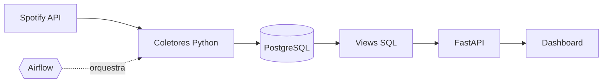

## Luisa Ferreira

**Engenheira de Dados Júnior** · Ciência da Computação @ UFRN 
Construo pipelines de dados: da ingestão via APIs à camada analítica.

---

### Sobre mim

- Foco em **Engenharia de Dados**: ingestão, modelagem, orquestração e qualidade de dados
- Estudando agora: **Airflow**, **SQL avançado** e modelagem dimensional (star schema, SCD2)
- Português (nativo) · Inglês (avançado) · Francês (intermediário)

### Stack

**Linguagens & Ingestão** 

**Orquestração & Processamento** 

**Bancos de dados** 

**BI, Infra & Versionamento** 

### Projeto em destaque: Spotify Analytics Pipeline

[Ver repositório →](https://github.com/luisaferreirass/spotify_analytics_pipeline)

### Outros projetos

| Projeto | O que faz | Stack |
|---|---|---|
| **[flight_search_app](https://github.com/luisaferreirass/flight_search_app)** | Ingestão automatizada da API Amadeus com persistência em banco | Python, API REST, SQL |
| **[data_clean](https://github.com/luisaferreirass/data_clean)** | Limpeza e tratamento de dados: ausentes, duplicatas, winsorização | Python, Pandas |
| **[HomeMatch](https://github.com/DevlTz/HomeMatch)** | Plataforma imobiliária com busca semântica (pgvector) e dados do Censo IBGE 2022 | Django, PostgreSQL, Celery, Redis |
