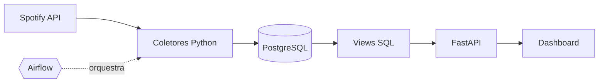
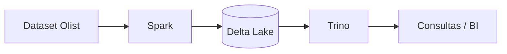

<!-- Header animado -->

<!-- Texto digitando -->

 

---

### 🧰 Stack

**Ingestão & Linguagens** 

**Lakehouse & Processamento** 

**Orquestração, Bancos & Infra** 

---

### ⭐ Projetos em destaque

<table>
<tr>
<td width="50%" valign="top">

#### 🎧 Spotify Analytics Pipeline
Pipeline ponta a ponta: coleta via API do Spotify, persistência em PostgreSQL, views SQL analíticas, API em FastAPI e dashboard. Tudo orquestrado com Airflow.

`Python` `Airflow` `PostgreSQL` `FastAPI`

</td>
<td width="50%" valign="top">

#### 🛒 Olist Lakehouse
Pipeline sobre o dataset público de e-commerce da Olist: transformações com Spark, tabelas em Delta Lake e consultas analíticas via Trino.

`Spark` `Delta Lake` `Trino`

</td>
</tr>
</table>

<b>Ver arquitetura dos dois projetos</b>

 

**Spotify Analytics Pipeline**

**Olist Lakehouse**

---

🗣️ Português (nativo) · Inglês (avançado) · Francês (intermediário)

